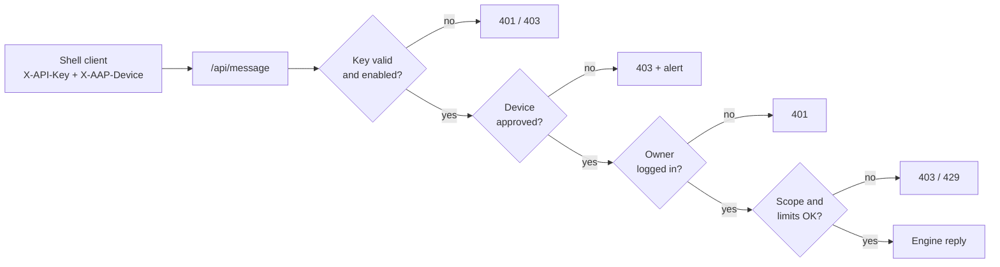
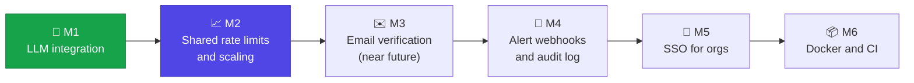

# Account-Bound API Key Protection (AAP)


API keys that are **useless when stolen**. A key is honored only when **all**
of these hold:

| # | Check | Fails with |
|---|-------|-----------|
| 1 | The key's owner is **logged in** to the web app right now | `401` |
| 2 | An admin has **enabled** the key | `403` |
| 3 | The request comes from a **device the owner approved** | `403` |
| 4 | The message is within the key's **scopes** and **usage limits** | `403` / `429` |

Log out, and the same key stops working immediately.



## Installation

You need **Node.js 20.19+**, **MongoDB**, and **Python 3** for the terminal clients.
An **Ollama** LLM is optional.

### Option A: guided setup (recommended)

```bash
git clone https://github.com/parag25mcf10022/API-Token_Abuse-protection-POC.git
cd API-Token_Abuse-protection-POC
npm run setup
```

`npm run setup` checks your machine (Node, Python, MongoDB, Ollama, RAM, GPU,
free disk) and does the following:

- runs `npm install`;
- offers to run `pip install -r requirements.txt`;
- offers to start MongoDB in Docker if it isn't running (~700 MB image);
- **asks before downloading any LLM model**, showing its size. Every prompt
  defaults to *No*.

Then continue at [Start the server](#start-the-server).

### Option B: manual setup

**1. Install the prerequisites**

| | Linux (Debian/Ubuntu) | macOS (Homebrew) | Windows |
|---|---|---|---|
| Node.js 20.19+ | `curl -fsSL https://deb.nodesource.com/setup_20.x \| sudo -E bash - && sudo apt install -y nodejs` | `brew install node@20` | installer from [nodejs.org](https://nodejs.org) |
| Python 3 | `sudo apt install -y python3 python3-venv python3-pip` | `brew install python` | installer from [python.org](https://python.org) (tick "Add to PATH") |
| MongoDB | [install guide](https://www.mongodb.com/docs/manual/administration/install-on-linux/) or `docker run -d --name aap-mongo -p 27017:27017 mongo:7` | `brew tap mongodb/brew && brew install mongodb-community && brew services start mongodb-community` | [MongoDB installer](https://www.mongodb.com/try/download/community) or Docker |
| Ollama *(optional)* | `curl -fsSL https://ollama.com/install.sh \| sh` | `brew install ollama` | installer from [ollama.com](https://ollama.com/download) |

Check them: `node -v` (≥ 20.19), `python3 --version`, and `mongosh --eval "db.runCommand({ping:1})"`
(or `docker ps` if you use the container).

**2. Get the code and install the server dependencies**

```bash
git clone https://github.com/parag25mcf10022/API-Token_Abuse-protection-POC.git
cd API-Token_Abuse-protection-POC
npm install
```

**3. Install the Python dependencies (`requirements.txt`)**

The terminal clients (`client.py`, `org_client.py`) need the packages listed in
`requirements.txt`. Use a virtual environment so nothing touches your system Python:

```bash
# Linux / macOS
python3 -m venv .venv
source .venv/bin/activate
pip install -r requirements.txt

# Windows (PowerShell)
py -m venv .venv
.venv\Scripts\Activate.ps1
pip install -r requirements.txt
```

Activate the environment again (`source .venv/bin/activate`) in any new terminal
before running the clients. If you'd rather not use a venv:
`pip install --user -r requirements.txt` (or `sudo apt install python3-requests`
on Debian-based systems).

**4. (Optional) Download LLM models**

Skip this step to use the built-in engine only. It answers calc/text commands,
questions about AAP, and short coding/security/design/data tips.

```bash
ollama pull llama3.2:3b        # ~2.0 GB — general answers (default model)
ollama pull qwen2.5-coder:7b   # ~4.7 GB — coding questions (optional)
```

Models can be added later. The server picks them up within a minute, with no
restart. If the coding model is missing, coding questions use the default model.

**Or use Claude (hosted, paid).** Set `ANTHROPIC_API_KEY` and either make
Claude the default or route only some categories to it:

```bash
export ANTHROPIC_API_KEY=sk-ant-...           # never commit this
LLM_PROVIDER=anthropic npm start              # Claude (claude-opus-5-5) for everything
LLM_MODEL_CODING=claude-sonnet-5-5 npm start  # local Ollama, Claude for coding only
```

Prompts sent to a Claude model leave the machine and are billed by Anthropic.
Each request's cost is recorded per model and shown to admins in the cost
guide, to users on the dashboard, and in the CLI. Without a key, Claude routes
fall back to the default model.

### Start the server

```bash
npm start                      # → http://localhost:3000
```

On first start the server creates a **super admin** (`admin@example.com`) and a
**demo user** (`user@example.com`), and prints their generated passwords
**once** in the terminal. Save them. To choose them yourself, start with
`ADMIN_PASSWORD='…' DEMO_USER_PASSWORD='…' npm start`. Other settings are listed
under [Configuration](#configuration).

### Use it

1. Open **http://localhost:3000** and log in. Click **Generate new key** (it asks
   for your password). You can view it again later with **Show key**.
2. In a terminal, with the venv active:
   ```bash
   AAP_API_KEY=ak_... python3 client.py
   # Windows PowerShell:  $env:AAP_API_KEY="ak_..."; py client.py
   ```
   The client prints a **pairing code**. Approve that device on the dashboard
   **of the account that owns the key** (approval is per account). While it
   waits, the client says what's missing: device approval, login, admin
   enable, or a locked or invalid key. For the last two you can paste a new key
   without restarting.
3. Chat. Replies stream in; `/help` lists commands. Log out in the browser and
   the key stops working.

```text
› Show a tiny Express middleware that checks an X-API-Key header
  ┌ javascript
  │ const apiKeyMiddleware = (req, res, next) => { … }
  └
  ↳ coding · llm · qwen2.5-coder:7b · 370 tok · 14.5s
```

CLI extras: `/usage` (quotas per category), `/model`, `/device`, `/clear`,
`/save chat.md`, one-shot `python3 client.py -p "question"`, and `--no-stream`.

### Troubleshooting

| Problem | Fix |
|---------|-----|
| `Failed to start AAP server … MongoDB` | Start MongoDB (`sudo systemctl start mongod`, `brew services start mongodb-community`, or the Docker command above), or set `MONGO_URL`. |
| `error: externally-managed-environment` from pip | Use the virtual environment from step 3. |
| `ModuleNotFoundError: No module named 'requests'` | Activate the venv (`source .venv/bin/activate`), then `pip install -r requirements.txt`. |
| Client keeps waiting after you approved the device | Make sure you approved it on the dashboard of the **account that owns the key**. The client tells you if it's approved for a different account. |
| Client says the key is not valid | The key was regenerated or revoked. Use **Show key** on the dashboard and paste it into the client. |
| `EADDRINUSE: port 3000` | Another process uses the port. Stop it or run `PORT=3001 npm start`. |
| Replies say "I don't have a canned answer" | No LLM is available. Install Ollama and pull a model (step 4), or ask your admin to allow LLM access. |

## Features

| Area | What you get |
|------|--------------|
| **Session binding** | The key works only while its owner has a live browser session (30 min idle, 8 h max). Users can log out of one browser or of all browsers. |
| **Device approval** | The CLI holds a private device token. New devices stay pending until the owner approves the pairing code. |
| **Key handling** | Keys are checked by SHA-256 hash and stored encrypted (AES-256-GCM, with the encryption key outside the DB). Owners can **view** or **rotate** their key with their password. Keys travel only in headers. |
| **Key viewing** | Needs a live session and the current password. 3 wrong passwords lock viewing for 15 minutes, end the session and alert admins. At most 10 views per hour. The key auto-hides after 30 seconds. |
| **Organizations** | Super admin → org admins → members, each with their own key. |
| **Own-password rule** | Every sensitive action (view, generate or rotate a key, protection setting, master key, password change) checks **the logged-in account's own password**, never anyone else's. Members added by an admin get a temporary password and must set their own before any key action, so admins never know member passwords. Changing your password logs out your other sessions. |
| **Org master key** | For management only. It works only from an org admin's approved device while that admin is logged in. Used with `org_client.py`. |
| **Scopes** | Each message is classified as `general`, `math`, `text`, `coding`, `cyber`, `design` or `data`, and is allowed only if it's within the key's scopes. |
| **Usage limits** | **Per-category daily quotas** (requests and tokens), so using one category never uses up another. Defaults are 100 requests and 100,000 tokens per category per day, and admins can override any category. Optional **account-wide ceilings** (requests/tokens per day or month) are clearly marked as affecting all categories. A per-minute burst limit guards against abuse. Set per user and per org pool, by admins only. |
| **Cost guide for admins** | The policy editor shows what one request costs in each category (measured from real usage, or an estimate until there's data): ~5–60 tokens answered locally, ~250–1,300 by the LLM, ~5,700 worst case. Every quota box gets a live estimate ("100,000 tokens ≈ 153 coding requests") and a warning when a token quota would run out before the request quota. |
| **Compromise auto-response** | Repeated use from unapproved devices, a key spreading to 5+ new unapproved devices in 24 h, wrong passwords while viewing the key, or 50+ limit-blocked calls in a day **automatically disable or rotate** the key. Org admins choose the action for their org; personal users choose for themselves. **Team/enterprise members need admin approval to regenerate**; personal users regenerate with their password. Admins can unlock false alarms. |
| **Quotas & notifications** | The dashboard lists every category with its own daily request and token quota, usage, remaining allowance, typical cost per request, and **why** a category is unavailable (not in your plan, blocked by your org, quota 0, used up). You're notified at **50%, 75%, 90% and 99%** of any quota, on the dashboard (with a pop-up while it's open) and inline in the CLI. Org-pool warnings reach every member. |
| **Context-aware classification** | Natural questions ("what's 2+3?", "summarize this", "center a div") land in the right category. Short follow-ups ("explain it more simply") keep the conversation's category; unrelated questions don't, even with a forged history. Blocked messages say which category they were put in and which ones you're allowed. |
| **Alerts** | Raised for a new device, a new-IP login, a login lockout, a limit hit, and a revoked key. Admins can revoke a key from an alert; the owner then generates the new one. |
| **LLM engine** | Local Ollama by default, with no API costs and no data leaving the machine. Claude models can be the default or serve chosen categories, with prompt caching, automatic refusal fallbacks and per-model cost tracking. Replies are streamed, chats are multi-turn, and each category gets its own system prompt (the cyber prompt is defensive only). Admins can route categories to different models and allow or block LLM use per user or org. Real token counts are metered against limits. Simple commands and product questions stay local and instant. |
| **Hardening** | Rate limits, login lockout, CSP with Trusted Types, input validation, output encoding, no default credentials. |

## Org management (master key)

```bash
export AAP_MASTER_KEY=mk_...           # generated by the org admin on their dashboard
python3 org_client.py overview
python3 org_client.py set-policy 7 --scopes general,coding --limit requestsPerDay=200 --cat coding=50
python3 org_client.py org-policy --limit requestsPerDay=5000
python3 org_client.py alerts
python3 org_client.py revoke 7
python3 org_client.py protection rotate     # alert | disable | rotate on compromise
python3 org_client.py approve-regen 7       # allow a locked member to regenerate
```

## API

All key-authenticated calls use headers. Keys in URLs or request bodies are
rejected.

| Method | Path | Auth | Purpose |
|--------|------|------|---------|
| POST | `/auth/signup` · `/auth/login` · `/auth/logout` · `/auth/logout-all` | — / session | Account and sessions |
| GET | `/auth/me` | session | Dashboard data |
| POST | `/auth/reveal-key` | session + password | View your current key (lockout + quota) |
| POST | `/auth/rotate-key` | session + password | New API key; old one dies (locked org members need approval) |
| POST | `/auth/protection` | session + password | Personal accounts: action on compromise |
| POST | `/auth/change-password` | session + current password | Set a new password; ends other sessions |
| POST | `/auth/notices/dismiss` | session | Mark one (`id`) or all quota notifications read |
| GET/POST | `/auth/devices` · `/auth/devices/{approve,remove}` | session | Manage devices |
| POST | `/auth/org/master-key` | org admin + password | New master key, shown once |
| GET | `/auth/session-status` | `X-API-Key`, `X-AAP-Device` | `{active, reason}`. Reasons: `invalid_key`, `device_not_approved`, `device_approved_for_other_account`; the owner's approved devices also get `no_session`, `key_disabled`, `key_locked` |
| POST | `/api/message` | `X-API-Key`, `X-AAP-Device` | Protected endpoint; `stream: true` for NDJSON, optional `history` |
| GET | `/api/usage` · `/api/engine` | `X-API-Key`, `X-AAP-Device` | Your limits/usage · engine status |
| * | `/api/admin/*` | admin session | Admin API |
| * | `/api/org/*` | `X-AAP-Master-Key`, `X-AAP-Device` | Same admin API, scoped to the org |

## Configuration

| Variable | Default | Purpose |
|----------|---------|---------|
| `PORT` | `3000` | HTTP port |
| `MONGO_URL` / `MONGO_DB` | `mongodb://localhost:27017` / `AAP` | Database |
| `SESSION_SECRET` | generated, stored in DB | Cookie signing |
| `KEY_ENCRYPTION_KEY` | generated in `.secrets/` (git-ignored) | 64-hex key that encrypts stored API keys |
| `TRUST_PROXY` | unset | Set to `1` behind a TLS proxy |
| `LLM_PROVIDER` | `ollama` | `ollama`, `anthropic` (Claude is the default model) or `none` (local engine only) |
| `OLLAMA_URL` | `http://localhost:11434` | Ollama server |
| `LLM_MODEL` | `llama3.2:3b` (`claude-opus-5-5` with `anthropic`) | Default model |
| `LLM_MODEL_<CATEGORY>` | coding: `qwen2.5-coder:7b` (Ollama only) | Per-category model from either provider (`claude-*` = Claude); `none` = use the default model |
| `LLM_MAX_TOKENS` / `LLM_TIMEOUT_MS` | `1024` / `90000` | Ollama reply cap, and timeout for both providers |
| `ANTHROPIC_API_KEY` | unset | Enables Claude models |
| `CLAUDE_MAX_TOKENS` | `16000` | Claude reply cap, thinking included |
| `CLAUDE_EFFORT` | `medium` | `low`, `medium`, `high`, `xhigh` or `max`: answer depth vs. cost |
| `LLM_PRICES` | built-in | JSON price overrides, USD per million tokens: `{"model":{"input":4,"output":20,"cacheRead":0.2}}` |
| `ADMIN_EMAIL` / `ADMIN_PASSWORD` | `admin@example.com` / random | Seeded super admin |
| `DEMO_USER_EMAIL` / `DEMO_USER_PASSWORD` | `user@example.com` / random | Seeded demo user |

## Project structure

```
server.js        Express app: auth, devices, /api/message, wiring
adminRoutes.js   Admin / org API (session or master key)
db.js            MongoDB data layer (users, orgs, devices, hashed keys)
keyVault.js      AES-256-GCM encryption for viewable API keys
policy.js        Categories, scope + limit validation
usage.js         Usage metering and limit checks
protection.js    Automatic disable/rotate on compromise signals
alerts.js        Security alerts
security.js      CSP headers, input validation
rateLimit.js     Per-IP rate limiter
engine.js        Response engine: rules, FAQ, LLM, content classifier
llm.js           LLM providers (Ollama, Claude): streaming, routing, prompts
pricing.js       Per-model prices for cost tracking
public/          Dashboard and admin panel (no inline scripts)
client.py        Shell client
scripts/setup.js Guided setup (checks system, asks before downloads)
requirements.txt Python dependencies for the CLIs
org_client.py    Org management CLI
```

## Scope notes

- **Email verification is not implemented yet.** It was left out on purpose to
  keep costs down (no mail provider) and the test scope small while the core
  works. Accounts are created without verifying the address, and recovery
  goes through passwords and admins. It's planned for **M3** (see below).
- The in-memory IP rate limiter is per process; shared limits are planned for
  M2.

## Roadmap



| Milestone | Goal | Key deliverables | Status |
|-----------|------|------------------|--------|
| **M1 — LLM integration** | Answer what the local engine can't | ✅ Local Ollama behind all checks · ✅ streaming + multi-turn · ✅ per-category routing and system prompts · ✅ real token metering · ✅ admin LLM on/off per user or org · ✅ hosted provider (Claude) with prompt caching · ✅ per-model cost tracking | ✅ Done |
| **M2 — Shared rate limits** | Run more than one instance | Move the IP limiter and quota checks to a shared store (Redis or MongoDB); atomic quota enforcement | 📋 Planned |
| **M3 — Email verification and recovery** | Production-ready accounts | Email verification at signup (skipped for now to cut costs and test scope); password reset by email; emails to the owner when a key is auto-locked or revoked | 📋 Planned · near future |
| **M4 — Alerting and audit** | Visibility for admins | Webhook/Slack/email delivery for alerts; exportable audit log of admin actions and key use | 📋 Planned |
| **M5 — SSO** | Enterprise onboarding | OIDC/SAML login per org; automatic member provisioning | 📋 Planned |
| **M6 — Packaging** | Easy deployment | Docker Compose (app + MongoDB); automated test suite in CI | 📋 Planned |

## License

[MIT](LICENSE) © 2026 Parag Bagade.

Dependencies keep their own licenses: Express, express-session and
connect-mongo (MIT); the MongoDB Node driver, the Anthropic SDK and Python
`requests` (Apache-2.0).
