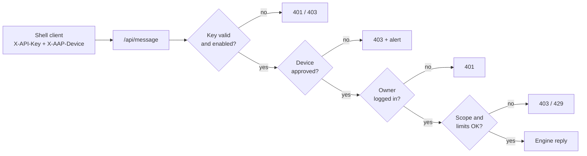
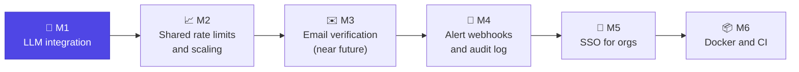

# Account-Bound API Key Protection (AAP)


API keys that are **useless when stolen**. A key is honored only when **all**
of these hold:

| # | Check | Fails with |
|---|-------|-----------|
| 1 | The key's owner is **logged in** to the web app right now | `401` |
| 2 | An admin has **enabled** the key | `403` |
| 3 | The request comes from a **device the owner approved** | `403` |
| 4 | The message is within the key's **scopes** and **usage limits** | `403` / `429` |

Log out, and the same key stops working immediately.



## Quick start

```bash
git clone https://github.com/parag25mcf10022/API-Token_Abuse-protection-POC.git
cd API-Token_Abuse-protection-POC
npm run setup      # checks your machine, installs small deps, asks before big downloads
npm start          # → http://localhost:3000
```

### Requirements

| Component | Needed for | Notes |
|-----------|-----------|-------|
| **Node.js 20.19+** | the server | required |
| **MongoDB** | storage | required. Setup detects it; if Docker is available it can start `mongo:7` for you (~700 MB, asks first) |
| **Python 3 + `requests`** | `client.py`, `org_client.py` | `pip install -r requirements.txt` (setup offers this) |
| **Ollama** + models | LLM answers | **optional**: `llama3.2:3b` (~2 GB) for general answers, `qwen2.5-coder:7b` (~4.7 GB) for coding |

`npm run setup` checks RAM, GPU and free disk space, and **asks before downloading
any model**. Every model prompt defaults to *No*. If you skip the models, the
**built-in engine** still answers calc/text commands, questions about AAP, and
short coding/security/design/data tips. LLM answers switch on automatically once
a model is installed (`ollama pull llama3.2:3b`), with no restart needed. If the
coding model is missing, coding questions use the default model.

Non-interactive: `npm run setup -- --no-input --skip-models` · accept everything:
`npm run setup -- --yes`.

### First run

On first boot the server creates a super admin and a demo user and prints
their generated passwords **once**. You can set them instead with
`ADMIN_PASSWORD` and `DEMO_USER_PASSWORD`.

1. Log in at `http://localhost:3000` and click **Generate new key**. You can
   view it again later with **Show key** and your password.
2. Run the client and approve its pairing code on your dashboard:
   ```bash
   AAP_API_KEY=ak_... python3 client.py
   ```
   While it waits, the client says exactly what's missing: device approval,
   login, admin enable, or a locked key, in which case you can paste the new
   key right in the client.
3. Chat. Replies stream in, with `/help` for commands. Log out in the browser and
   the key stops working.

```text
› Show a tiny Express middleware that checks an X-API-Key header
  ┌ javascript
  │ const apiKeyMiddleware = (req, res, next) => { … }
  └
  ↳ coding · llm · qwen2.5-coder:7b · 370 tok · 14.5s
```

CLI extras: `/usage` (meters against your limits), `/model`, `/device`, `/clear`,
`/save chat.md`, one-shot `python3 client.py -p "question"`, and `--no-stream`.

## Features

| Area | What you get |
|------|--------------|
| **Session binding** | The key works only while its owner has a live browser session (30 min idle, 8 h max). Users can log out of one browser or of all browsers. |
| **Device approval** | The CLI holds a private device token. New devices stay pending until the owner approves the pairing code. |
| **Key handling** | Keys are checked by SHA-256 hash and stored encrypted (AES-256-GCM, with the encryption key outside the DB). Owners can **view** or **rotate** their key with their password. Keys travel only in headers. |
| **Key viewing** | Needs a live session and the current password. 3 wrong passwords lock viewing for 15 minutes, end the session and alert admins. At most 10 views per hour. The key auto-hides after 30 seconds. |
| **Organizations** | Super admin → org admins → members, each with their own key. |
| **Own-password rule** | Every sensitive action (view, generate or rotate a key, protection setting, master key, password change) checks **the logged-in account's own password**, never anyone else's. Members added by an admin get a temporary password and must set their own before any key action, so admins never know member passwords. Changing your password logs out your other sessions. |
| **Org master key** | For management only. It works only from an org admin's approved device while that admin is logged in. Used with `org_client.py`. |
| **Scopes** | Each message is classified as `general`, `math`, `text`, `coding`, `cyber`, `design` or `data`, and is allowed only if it's within the key's scopes. |
| **Usage limits** | Requests per minute, day and month; tokens per day and month; daily caps per category. Set per user and per org pool, by admins only. |
| **Compromise auto-response** | Repeated use from unapproved devices, a key spreading to 5+ new unapproved devices in 24 h, wrong passwords while viewing the key, or 50+ limit-blocked calls in a day **automatically disable or rotate** the key. Org admins choose the action for their org; personal users choose for themselves. **Team/enterprise members need admin approval to regenerate**; personal users regenerate with their password. Admins can unlock false alarms. |
| **Alerts** | Raised for a new device, a new-IP login, a login lockout, a limit hit, and a revoked key. Admins can revoke a key from an alert; the owner then generates the new one. |
| **LLM engine** | Local Ollama by default, with no API costs and no data leaving the machine. Replies are streamed, chats are multi-turn, and each category gets its own system prompt (the cyber prompt is defensive only). Admins can route categories to different models and allow or block LLM use per user or org. Real token counts are metered against limits. Simple commands and product questions stay local and instant. |
| **Hardening** | Rate limits, login lockout, CSP with Trusted Types, input validation, output encoding, no default credentials. |

## Org management (master key)

```bash
export AAP_MASTER_KEY=mk_...           # generated by the org admin on their dashboard
python3 org_client.py overview
python3 org_client.py set-policy 7 --scopes general,coding --limit requestsPerDay=200 --cat coding=50
python3 org_client.py org-policy --limit requestsPerDay=5000
python3 org_client.py alerts
python3 org_client.py revoke 7
python3 org_client.py protection rotate     # alert | disable | rotate on compromise
python3 org_client.py approve-regen 7       # allow a locked member to regenerate
```

## API

All key-authenticated calls use headers. Keys in URLs or request bodies are
rejected.

| Method | Path | Auth | Purpose |
|--------|------|------|---------|
| POST | `/auth/signup` · `/auth/login` · `/auth/logout` · `/auth/logout-all` | — / session | Account and sessions |
| GET | `/auth/me` | session | Dashboard data |
| POST | `/auth/reveal-key` | session + password | View your current key (lockout + quota) |
| POST | `/auth/rotate-key` | session + password | New API key; old one dies (locked org members need approval) |
| POST | `/auth/protection` | session + password | Personal accounts: action on compromise |
| POST | `/auth/change-password` | session + current password | Set a new password; ends other sessions |
| GET/POST | `/auth/devices` · `/auth/devices/{approve,remove}` | session | Manage devices |
| POST | `/auth/org/master-key` | org admin + password | New master key, shown once |
| GET | `/auth/session-status` | `X-API-Key`, `X-AAP-Device` | `{active}`, plus a `reason` only for the owner's approved devices |
| POST | `/api/message` | `X-API-Key`, `X-AAP-Device` | Protected endpoint; `stream: true` for NDJSON, optional `history` |
| GET | `/api/usage` · `/api/engine` | `X-API-Key`, `X-AAP-Device` | Your limits/usage · engine status |
| * | `/api/admin/*` | admin session | Admin API |
| * | `/api/org/*` | `X-AAP-Master-Key`, `X-AAP-Device` | Same admin API, scoped to the org |

## Configuration

| Variable | Default | Purpose |
|----------|---------|---------|
| `PORT` | `3000` | HTTP port |
| `MONGO_URL` / `MONGO_DB` | `mongodb://localhost:27017` / `AAP` | Database |
| `SESSION_SECRET` | generated, stored in DB | Cookie signing |
| `KEY_ENCRYPTION_KEY` | generated in `.secrets/` (git-ignored) | 64-hex key that encrypts stored API keys |
| `TRUST_PROXY` | unset | Set to `1` behind a TLS proxy |
| `LLM_PROVIDER` | `ollama` | `ollama` or `none` (local engine only) |
| `OLLAMA_URL` | `http://localhost:11434` | Ollama server |
| `LLM_MODEL` | `llama3.2:3b` | Default model |
| `LLM_MODEL_<CATEGORY>` | coding: `qwen2.5-coder:7b` | Per-category model; `none` = use the default model |
| `LLM_MAX_TOKENS` / `LLM_TIMEOUT_MS` | `1024` / `90000` | Reply cap and timeout |
| `ADMIN_EMAIL` / `ADMIN_PASSWORD` | `admin@example.com` / random | Seeded super admin |
| `DEMO_USER_EMAIL` / `DEMO_USER_PASSWORD` | `user@example.com` / random | Seeded demo user |

## Project structure

```
server.js        Express app: auth, devices, /api/message, wiring
adminRoutes.js   Admin / org API (session or master key)
db.js            MongoDB data layer (users, orgs, devices, hashed keys)
keyVault.js      AES-256-GCM encryption for viewable API keys
policy.js        Categories, scope + limit validation
usage.js         Usage metering and limit checks
protection.js    Automatic disable/rotate on compromise signals
alerts.js        Security alerts
security.js      CSP headers, input validation
rateLimit.js     Per-IP rate limiter
engine.js        Response engine: rules, FAQ, LLM, content classifier
llm.js           Ollama client: streaming, model routing, system prompts
public/          Dashboard and admin panel (no inline scripts)
client.py        Shell client
scripts/setup.js Guided setup (checks system, asks before downloads)
requirements.txt Python dependencies for the CLIs
org_client.py    Org management CLI
```

## Scope notes

- **Email verification is not implemented yet.** It was left out on purpose to
  keep costs down (no mail provider) and the test scope small while the core
  works. Accounts are created without verifying the address, and recovery
  goes through passwords and admins. It's planned for **M3** (see below).
- The in-memory IP rate limiter is per process; shared limits are planned for
  M2.

## Roadmap



| Milestone | Goal | Key deliverables | Status |
|-----------|------|------------------|--------|
| **M1 — LLM integration** | Answer what the local engine can't | ✅ Local Ollama behind all checks · ✅ streaming + multi-turn · ✅ per-category routing and system prompts · ✅ real token metering · ✅ admin LLM on/off per user or org · ⏳ hosted providers (e.g. Claude) with prompt caching · ⏳ per-model cost tracking | 🚧 In progress |
| **M2 — Shared rate limits** | Run more than one instance | Move the IP limiter and quota checks to a shared store (Redis or MongoDB); atomic quota enforcement | 📋 Planned |
| **M3 — Email verification and recovery** | Production-ready accounts | Email verification at signup (skipped for now to cut costs and test scope); password reset by email; emails to the owner when a key is auto-locked or revoked | 📋 Planned · near future |
| **M4 — Alerting and audit** | Visibility for admins | Webhook/Slack/email delivery for alerts; exportable audit log of admin actions and key use | 📋 Planned |
| **M5 — SSO** | Enterprise onboarding | OIDC/SAML login per org; automatic member provisioning | 📋 Planned |
| **M6 — Packaging** | Easy deployment | Docker Compose (app + MongoDB); automated test suite in CI | 📋 Planned |

## License

[MIT](LICENSE) © 2026 Parag Bagade.

Dependencies keep their own licenses: Express, express-session and
connect-mongo (MIT); the MongoDB Node driver and Python `requests`
(Apache-2.0).
